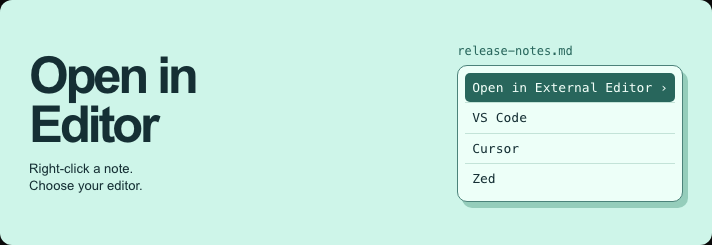

# Open in Editor

  

Open an Obsidian note or folder in VS Code, Cursor, Zed, Windsurf, or Antigravity from the right-click menu. Use your editor’s search, multi-cursor editing, or bulk replace on files in your vault.

**Obsidian desktop · macOS, Windows, and Linux**

[Download the latest release](https://github.com/PriyanshuMallick/Obsidian_open_in_editor/releases/latest)

## Install

1. Download `main.js`, `manifest.json`, and `styles.css` from the latest release.
2. Copy them into `<vault>/.obsidian/plugins/open-in-editor/`.
3. Reload Obsidian and enable **Open in Editor** under **Settings → Community plugins**.

## Open files and folders

Enable an editor under **Settings → Open in Editor**. Then right-click a file or folder in the file explorer, or an open note’s tab, and choose **Open in [editor name]**. You can also open the current file from the command palette. If you just enabled an editor, reload the plugin to refresh its palette commands.

Enable **Group** for an editor to move its entry into the **Open in External Editor** submenu. To use another editor, choose **Add Custom Editor** and enter its application name on macOS or its executable command on Windows or Linux. For a custom editor on Windows, point to the .exe file.

## Development

Run `bun install` and `bun run build`. The build writes `dist/main.js`. To test it in a vault, follow the install steps using that file and the local manifest and stylesheet.

[Report an issue](https://github.com/PriyanshuMallick/Obsidian_open_in_editor/issues) · [MIT license](LICENSE)
