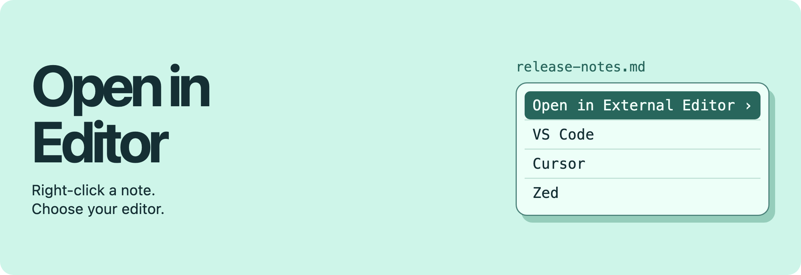

# Open in Editor

  

Open notes and folders from Obsidian in VS Code, Cursor, Zed, Windsurf, or Antigravity. You can also add your own editor.

**Obsidian desktop · macOS, Windows, and Linux**

## Install

1. In Obsidian, go to **Settings → Community plugins → Browse**.
2. Search for **Open in Editor**.
3. Select **Install**, then **Enable**.

## Open a note or folder

1. Go to **Settings → Open in Editor** and enable the editors you use.
2. Right-click a note or folder in the file explorer, or an open note’s tab.
3. Choose **Open in** followed by the editor name.

Enable **Group** to put an editor under **Open in External Editor**. To open the current note from the command palette, search for **Open current file in**. Reload the plugin after enabling an editor to refresh its palette commands.

## Add a custom editor

Choose **Add Custom Editor** in the plugin settings. Enter the application name on macOS, the path to its `.exe` on Windows, or its executable command on Linux. Then enable the editor.

[Manual install and development](DEVELOPMENT.md) · [Report an issue](https://github.com/PriyanshuMallick/Obsidian_open_in_editor/issues) · [MIT license](LICENSE)
